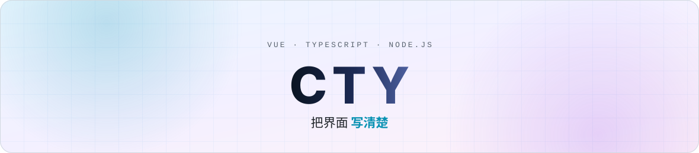

# 你好，我是 cty 👋

<picture>
  <source media="(prefers-color-scheme: dark)" srcset="./banner-dark.svg">
  <source media="(prefers-color-scheme: light)" srcset="./banner-light.svg">
  
</picture>

- 🚀 主力 **React / Next.js / TypeScript / Tailwind**，先把界面做好看
- 🧰 后端胶水 **Node.js + Express**，顺手写点 Go / Python
- 🌱 在学 **RSC 与边缘渲染**，也爱把 Windows 玩成服务器
- 📫 聊天、换坑、问问题，QQ / 微信 / 邮箱都在下面

 

### // 技术栈

**FRONTEND · 主力**

<picture>
  <source media="(prefers-color-scheme: dark)" srcset="https://skillicons.dev/icons?i=react,nextjs,ts,js,tailwind,html,css,vite&theme=dark&perline=8">
  
</picture>

**NODE.JS**

<picture>
  <source media="(prefers-color-scheme: dark)" srcset="https://skillicons.dev/icons?i=nodejs,npm,express&theme=dark&perline=3">
  
</picture>

**LANGUAGE**

<picture>
  <source media="(prefers-color-scheme: dark)" srcset="https://skillicons.dev/icons?i=go,py&theme=dark&perline=2">
  
</picture>

**BACKEND · INFRA**

<picture>
  <source media="(prefers-color-scheme: dark)" srcset="https://skillicons.dev/icons?i=docker,nginx,linux,postgres,redis&theme=dark&perline=5">
  
</picture>

**TOOLING**

<picture>
  <source media="(prefers-color-scheme: dark)" srcset="https://skillicons.dev/icons?i=git,bash,powershell&theme=dark&perline=3">
  
</picture>

 

### // 找到我

 

### // 数据

 

> 界面要好看，服务要自己跑，胶水要自己写。

© 2026 CTY · BUILT IN THE OPEN · <a href="https://github.com/cty1735">GITHUB.COM/CTY1735</a>

